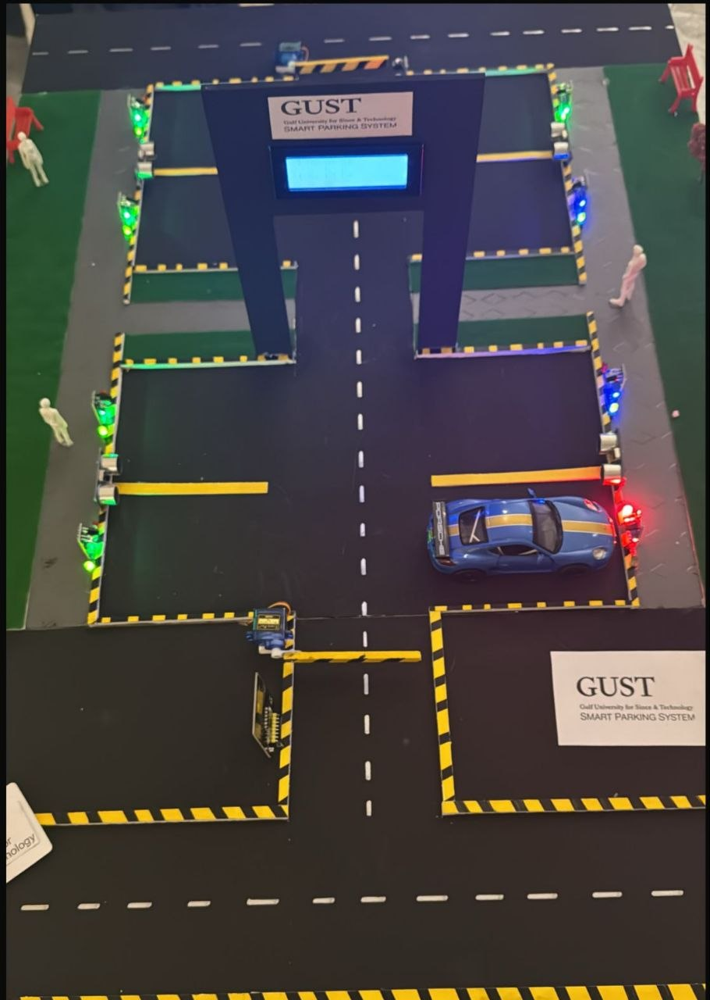

# SmartPark — Smart Parking & Access Control System

> *Your space, our intelligence.*

An Arduino-based smart parking prototype that detects which spots are free, shows live availability with LEDs, warns drivers who park incorrectly, and controls who can enter using RFID.

Built as a design project at the **College of Engineering & Architecture, Gulf University for Science and Technology (GUST)**, 2025–2026 academic year.



---

## The Problem

Finding parking on campus and around Kuwait wastes time and causes stress. In our user interviews, people said they:

- arrive early to meetings just to find a spot
- miss lectures while looking for parking
- sometimes take up two spots without noticing
- see unauthorized cars using restricted parking areas

**Opportunity statement:** *How might we design an affordable smart parking system that improves parking efficiency, enhances user experience, and increases space utilization?*

---

## Features

| Feature | How it works |
|---|---|
| **Occupancy detection** | 8 IR sensors detect whether a car is in each slot (zones A1–A4 and B1–B4) |
| **Live availability** | Each slot has a green LED (free) and a red LED (occupied) |
| **Incorrect-parking alert** | 4 ultrasonic sensors sound a buzzer when a car is closer than 7 cm |
| **RFID gate** | Scanning an RFID card opens a servo barrier for 2 seconds |
| **IR entrance gate** | An IR sensor at the entrance detects an arriving car and opens a second barrier |
| **Status display** | A 20×4 I2C LCD shows a live map of both zones (`O` = free, `X` = occupied) |

---

## Design Process

During ideation, we compared mobile apps, camera-based systems, digital signage, and sensor-based approaches by **cost, feasibility, accuracy, and ease of implementation**. We chose a sensor-based Arduino solution because it gave the best balance of functionality, simplicity, and affordability.

---

## Hardware

- Arduino Mega 2560
- 9 × IR obstacle sensors (8 slots + 1 entrance gate)
- 4 × HC-SR04 ultrasonic sensors
- MFRC522 RFID reader with cards/tags
- 2 × SG90 servo motors (IR gate and RFID gate)
- 20×4 LCD with I2C backpack (address `0x27`)
- Active buzzer
- 8 × green LEDs, 8 × red LEDs, and resistors
- Breadboard, jumper wires, and power supply
- Scale model of the parking lot (two parking zones with an entrance gate)

---

## Pin Connections (Arduino Mega)

### Parking slots

| Slot | IR sensor | Green LED | Red LED |
|:---:|:---:|:---:|:---:|
| A1 | 30 | 38 | 39 |
| A2 | 31 | 40 | 41 |
| A3 | 32 | 42 | 43 |
| A4 | 33 | 44 | 45 |
| B1 | 34 | 46 | 47 |
| B2 | 35 | 48 | 49 |
| B3 | 36 | 11 | 10 |
| B4 | 37 | 3 | 4 |

### Other components

| Component | Pin(s) |
|---|:---:|
| Ultrasonic 1 (TRIG / ECHO) | 22 / 23 |
| Ultrasonic 2 (TRIG / ECHO) | 24 / 25 |
| Ultrasonic 3 (TRIG / ECHO) | 26 / 27 |
| Ultrasonic 4 (TRIG / ECHO) | 28 / 29 |
| Buzzer | 2 |
| Entrance gate IR sensor | 6 |
| Entrance gate servo | 9 |
| RFID gate servo | 7 |
| RFID SDA (SS) / RST | 53 / 5 |
| RFID SCK / MOSI / MISO | 52 / 51 / 50 |
| LCD SDA / SCL | 20 / 21 |

> **Note:** The IR sensors are active-LOW, so a `LOW` reading means a car is detected.

---

## Software

### Required libraries

Install these from the Arduino IDE Library Manager:

- **NewPing** — ultrasonic sensors
- **LiquidCrystal_I2C** — LCD
- **MFRC522** — RFID reader
- **Servo**, **Wire**, **SPI** — built into the Arduino IDE

### How the code works

Each pass of `loop()` (about every 200 ms), the code:

1. Reads the 4 ultrasonic sensors and sounds the buzzer if any car is closer than 7 cm.
2. Reads the 8 slot IR sensors and switches each slot's LED to green (free) or red (occupied).
3. Updates the LCD map of zones A and B.
4. Opens the entrance gate for 2 seconds if the gate IR sensor detects a car.
5. Opens the RFID gate for 2 seconds when a card is scanned, and prints the card's UID to the Serial Monitor.

### Upload

1. Clone or download this repository.
2. Open `SmartPark.ino` in the Arduino IDE. If it asks to move the file into a folder named `SmartPark`, click **OK**.
3. Install the libraries listed above.
4. Select **Arduino Mega or Mega 2560** and your port, then click **Upload**.
5. Open the Serial Monitor at **9600 baud** to see sensor distances and scanned RFID UIDs.

---

## Repository Structure

```
SmartPark/
├── SmartPark.ino        # Main Arduino sketch
├── images/
│   ├── prototype.jpg    # Photo of the physical model
│   └── poster.png       # Project poster
└── README.md
```

---

## User Testing Feedback

- Testers saw it as a useful way to ease Kuwait's parking shortage in many sectors.
- They liked its holistic approach, which covers the entrance, finding a spot, and parking itself.
- **Suggestion:** a companion mobile app that shows available spots in real time.
- **Concern:** drivers in a hurry may ignore the incorrect-parking alarm.

---

## Future Work

- Mobile app showing live slot availability
- Wi-Fi/IoT connectivity (e.g., ESP32) to publish slot status to the cloud
- Accept only registered RFID cards (whitelist of UIDs)
- Stronger enforcement for incorrect parking (e.g., notifications or logging)

---

## Team

| Name |
|---|
| Shaikha Aljadi |
| Abyar Alfayrooz |
| Rayan Alshatti |
| Asma Alenezi |

**Academic Supervisor:** Prof. Bulent Yilmaz

---

<p align="center"><i>Gulf University for Science and Technology — College of Engineering & Architecture, 2025–2026</i></p>
